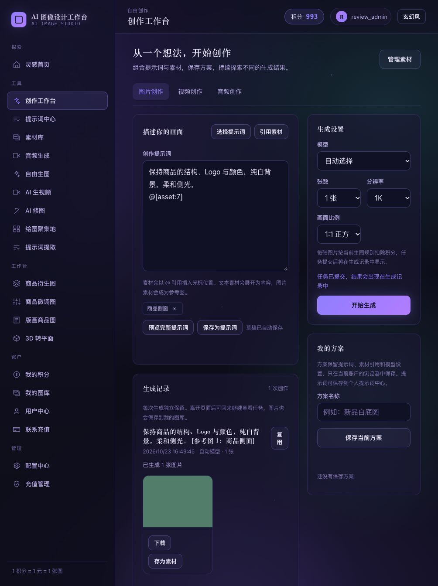
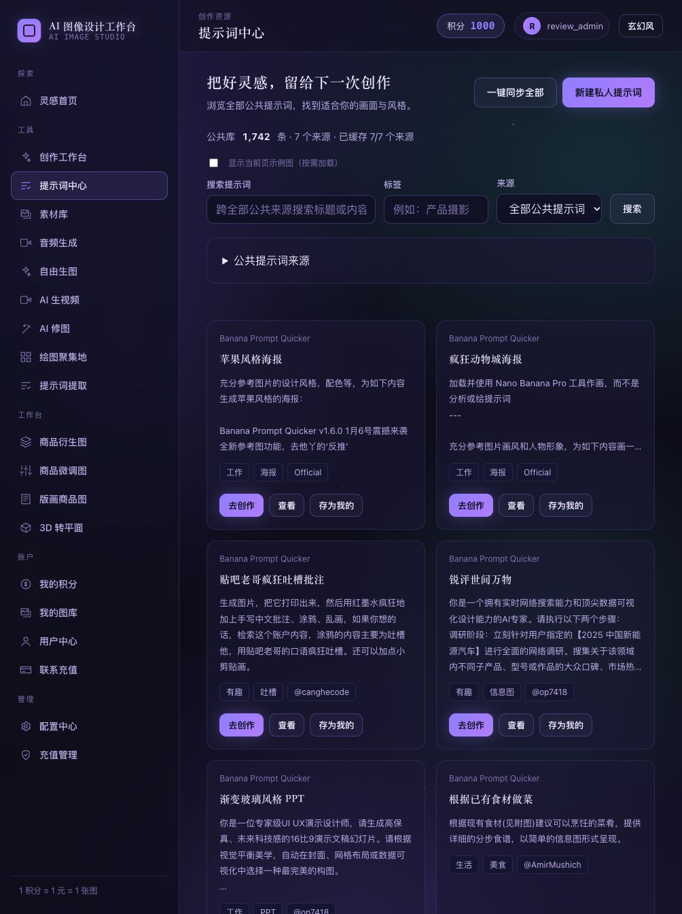
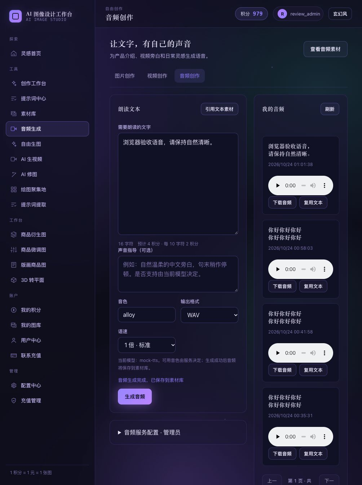

# 创作资源接入与图片性能优化

本轮在 `ljd/creative-workbench` 分支实现；旧页面、商品套图类型、默认参数、图像归一化规则、图像/视频成功后扣费规则保持兼容。新功能以独立入口接入，尚未部署生产。

## 新入口

| 地址 | 功能 |
| --- | --- |
| `/prompts` | 默认浏览全部公共提示词、跨八源搜索/标签、一键全量同步、私人提示词管理、存为自己的副本、带入创作 |
| `/assets` | 私有图片/视频/音频上传、文本素材、标签/收藏、搜索分页、详情和下载；引用已有图库作品 |
| `/workbench` | 图片创作、提示词选择、文本/图片素材引用、最终提示词预览、多参考图、批次历史与方案；链接原视频页及新音频页 |
| `/audio` | 文字转语音、声音/格式/语速/声音指令、费用预估、音频历史和下载、中断任务核对 |

音频配置只允许管理员保存，配置中心有入口。配置项包括兼容 `/audio/speech` 的 API Base URL（通常包含 `/v1`）、Key、模型、每档字符数、每档积分。Key 不发送回前端，未配置时不会请求模型。

字符计费公式：`ceil(Array.from(prompt.trim()).length / charactersPerCredit) * creditsPerUnit`。默认每 1000 字符 1 积分，管理员可调整。新音频任务提交时暂占预计费用；成功结算，明确失败释放。中断后可核对已有文件并结算，或在没有已知输出时释放预占；核对不会再次调用模型。旧生图和视频继续原有成功后扣费逻辑。

引用编排支持 `@[asset:ID]`：文本展开为内容，图片按出现顺序编号并去重，提交前验证当前用户对素材和原件的访问权。当前图片创作引用文本与图片；音视频可在素材库管理，视频生成仍使用原视频工作台支持的输入。

新方案、草稿和批次界面历史按用户 ID 保存在当前浏览器；提示词、素材、生成任务保存在服务端，图片结果继续进入原图库。上传素材不会公开发布。删除图库引用素材仅删除引用，不删除原图库文件。

公共提示词按上游原始 ID 保留所有案例，不按相同标题/正文合并。保留封面、参考图链接、描述、作者和原始来源；默认展示示例图并懒加载。首次缺缓存自动同步，更新失败保留已缓存内容；私人提示词与公共库分开查询和管理。新增的 ImgEdify Nano Banana Pro 来源只保留前 1000 条非敏感记录，不加载其第三方示例图，保留作者和原始链接。

## 图片为什么慢，以及本轮处理

核对 Infinite Canvas 的固定提交 `3a6b64b`：它单独缓存最大边 768px 的 WebP 预览，原图用于详情/编辑/生成引用，同时减少不可见节点和重复 DOM 更新。

本项目原来已有图库缩略图，但仍有这些成本：

1. 首页示例直接展示数 MB 的 PNG，CSS 背景也请求原图。
2. 老图库缩略图沿用 PNG 格式，首次请求启动外部转换；同图并发访问可能重复转换，并可能读到转换过程中的文件。
3. 公开作品 `no-store` 导致重复传输；“加载更多”重建已有卡片。
4. 部分创作列表和历史卡片展示原图；媒体下载与 Range 请求先把整个文件读进内存。

本轮：使用服务端已有的 ImageMagick 生成独立 WebP；同图并发合并、两路转换队列、临时文件原子发布、原件变更时重新生成；生成结果后台补预览；页面卡片使用预览和异步解码；首页追加分页保留已有 DOM；卡片去除大面积背景模糊；媒体文件流式返回并支持条件请求与 Range。原图、下载、编辑和模型参考仍使用原文件。

公开作品采用 `private, no-cache` + ETag，**每次先确认作品仍公开，再允许 304**，不会绕过撤回权限。JS/CSS 也支持 ETag，避免发布后仍加载旧脚本，同时减少重复传输。

### 本机实测（真实现有图片）

| 样本 | 优化前 | 优化后 | 说明 |
| --- | ---: | ---: | --- |
| 首页示例 PNG | 3,347,004 字节 | 110,758 字节 | 卡片传输量减少约 96.7%，原件保留 |
| 图库同一图片旧预览 | 400px PNG，225,580 字节 | 768px WebP，92,036 字节 | 更高预览分辨率，传输量减少约 59.2% |
| 同一图库原件 | 4,719,517 字节 | 92,036 字节预览 | 说明使用原图的创作列表可减少约 98.0% |
| 重复请求预览 | 完整正文 | 304，0 字节正文 | 权限校验仍执行 |

浏览器已确认卡片使用预览 URL，屏幕外图片延迟加载，原图仅在详情读取。以上属于本机测试；未测量生产域名的网络、服务器负载或真实滚动帧率。

## 服务端与部署

新增依赖仅更新 `mysql2` 至已修复版本。预览使用生产机已有的 ImageMagick `convert`，部署仍使用更新后的 `package-lock.json` 执行 `npm ci`；现有 Python 和图片规格归一化工具仍保留。

启动时创建独立新表：`generation_tasks`、`creative_prompts`、`creative_assets`、`creative_prompt_cache`、`creative_audio_config`；音频素材通过 `generation_task_id` 唯一关联任务，恢复时不依赖临时消息。已存在的新素材表会幂等补该列和索引。旧业务表不重构，生产数据库迁移尚未执行。部署前应按既有发布流程备份数据库并确认新表权限。

新数据目录：

- `generated-images/product-design/.thumbs/webp-v1/`：可再生预览缓存。
- `generated-images/product-design/.creative-assets/`：新上传及音频原件，属于需要备份的数据。
- `generated-images/.task-state/`：旧业务任务的本地结果日志。数据库状态写入故障不会改变已知生成结果，也不会重复扣费。

旧任务仍通过原 URL 返回结果。任务重启后保留已完成结果；无法确认的在途任务标记中断，不自动重新提交上游。该实现按当前单进程部署设计；多实例运行需协调启动恢复与共享文件存储。

## 验证

- 原有 58 项测试作为修改前基线。
- 新增预览并发/原子写入、Range/304、素材所有权、引用、来源缓存、音频字符计费与恢复、任务幂等与存储故障、前端草稿隔离等测试。
- `npm test`：163 项全部通过；包含原有基线及新增回归。
- `tests/creative-smoke.js http://127.0.0.1:4175` 仅允许指定隔离测试地址。真实本机 MySQL 独立库 + 本机模拟图片/视频/语音模型，覆盖原主图、批量衍生、提示词提取、视频、打包下载及新资源流程。
- 真实隔离 MySQL 验证音频中断无输出退款、有输出完成结算和重复核对幂等。
- 浏览器验证提示词保存→工作台复用→素材引用→提示词预览→生成结果，以及音频费用预估→生成→保存素材；未见脚本错误。
- 七个固定公共 JSON 来源均已实际接入。最新上游清单为 323、494、541、53、76、126、129 条，共 1742 条；完整同步的逐源核对见 `prompt-sync-audit.json`。

实际付费图片、视频和音频模型调用未执行；不同供应商的模型、音色、格式和输出质量仍须使用已授权的真实配置验收。本机示例生成使用模拟数据。

### 浏览器验收截图

以下为本机隔离环境，生成图片使用模拟上游返回的色块，账户与积分也是测试数据。

